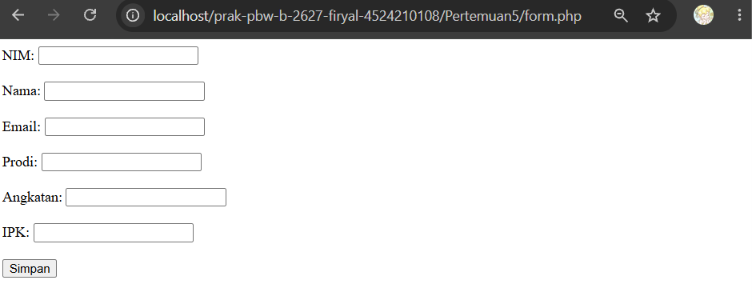
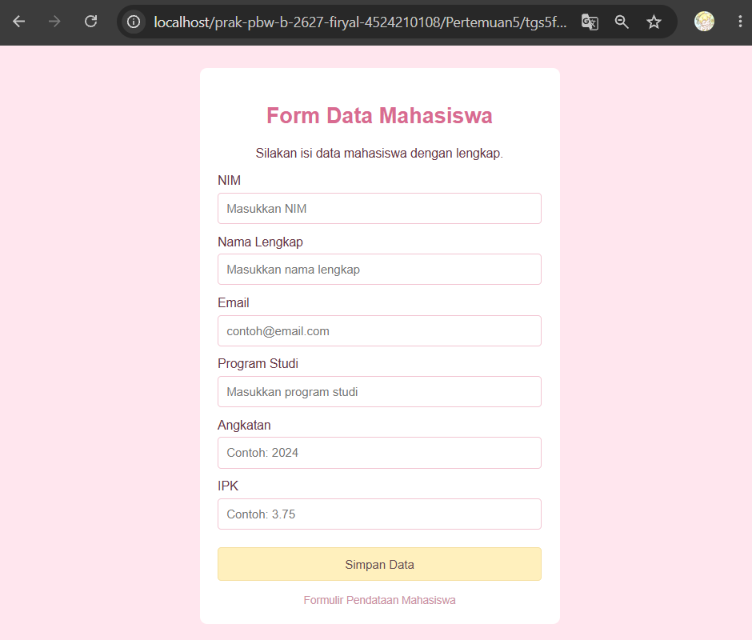
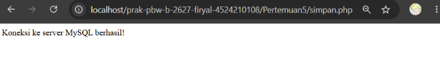
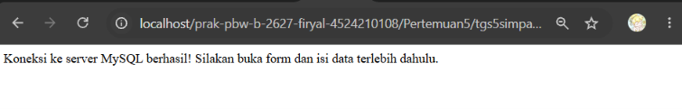

 <div align="center">

<h1 style="font-size: 18px; margin-bottom: 5px; border: none;">
LAPORAN PRAKTIKUM <br>
PEMROGRAMAN BERBASIS WEB
</h1>

<p style="font-size: 12px; color: #555;">
<i>Laporan ini disusun guna memenuhi penilaian dalam mata kuliah Prak. Pemrograman Berbasis Web</i>
</p>

<br>


<br><br>

<p style="font-size: 14px; margin-bottom: 5px;">
<b>Disusun Oleh:</b>
</p>

<p style="font-size: 15px; margin-top: 5px;">
<b>Firyal Nibras Hariyadi</b><br>
4524210108
</p>

<br>

<p style="font-size: 14px; margin-bottom: 5px;">
<b>Dosen:</b>
</p>

<p style="font-size: 14px; margin-top: 5px;">
Ari Wibowo, S.Kom., M.Kom., C. Pro
</p>

<br><br><br>

<h3 style="font-size: 16px; margin-bottom: 5px; border: none;">
S1-TEKNIK INFORMATIKA <br>
FAKULTAS TEKNIK UNIVERSITAS PANCASILA <br>
<b>2026/2027</b>
</h3>

</div>

---

# Tugas Praktikum 5

Pada tugas ini dibuat form pendataan mahasiswa menggunakan HTML dan CSS serta proses penyimpanan data menggunakan PHP dan MySQL. Data yang dimasukkan meliputi NIM, nama, email, program studi, angkatan, dan IPK. Data dikirim melalui form dan disimpan ke dalam tabel `mahasiswa` pada database `akademik`.

## 1. Menjalankan Program

### A. tgs5form.php

**Hasil Running Sebelum Modifikasi**



**Hasil Running Setelah Modifikasi**



**Penjelasan**

Program `tgs5form.php` digunakan untuk membuat form pendataan mahasiswa. Modifikasi dilakukan pada tampilan menggunakan CSS, yaitu mengubah latar belakang menjadi pink pastel, memberikan warna putih pada form, serta menggunakan warna kuning pastel pada tombol Simpan Data.

### B. tgs5simpan.php

**Hasil Running Sebelum Modifikasi**



**Hasil Running Setelah Modifikasi**



**Penjelasan**

Program `tgs5simpan.php` digunakan untuk menerima data dari form dan menyimpannya ke tabel `mahasiswa` menggunakan perintah `INSERT`. Setelah dimodifikasi, program memeriksa apakah data telah dikirim melalui form dan menampilkan detail data mahasiswa apabila penyimpanan berhasil.

## 2. Modifikasi Program

### A. tgs5form.php

Modifikasi pada program `tgs5form.php` dilakukan dengan memperbaiki tampilan form menggunakan CSS. Perubahan yang dilakukan meliputi:

- Mengubah warna latar belakang menjadi pink pastel.
- Mengatur form dengan latar putih dan sudut membulat.
- Mengubah warna judul agar sesuai dengan tampilan form.
- Menggunakan warna kuning pastel pada tombol Simpan Data.
- Menambahkan efek perubahan warna ketika kursor diarahkan ke tombol.

### B. tgs5simpan.php

Modifikasi pada program `tgs5simpan.php` dilakukan pada proses pengecekan dan penampilan hasil penyimpanan data. Perubahan yang dilakukan meliputi:

- Menambahkan `isset($_POST['nim'])` untuk memeriksa apakah data telah dikirim melalui form.
- Menampilkan pesan keberhasilan setelah data berhasil disimpan.
- Menampilkan detail data mahasiswa yang telah dimasukkan.
- Menampilkan pesan apabila form belum dikirim.
- Menampilkan informasi kesalahan MySQL apabila penyimpanan gagal.

## 3. Lima Kode yang Menurut Saya Penting

1. **Menghubungkan form dengan file PHP**

   ```html
   <form action="tgs5simpan.php" method="POST">
   ```

   Kode ini digunakan untuk mengirimkan data form ke file `tgs5simpan.php` menggunakan metode `POST`.

2. **Membuat input data mahasiswa**

   ```html
   <input type="text" id="nim" name="nim"
          placeholder="Masukkan NIM" required>
   ```

   Kode ini digunakan untuk menerima NIM mahasiswa. Atribut `name` menentukan nama data yang diterima PHP, sedangkan `required` membuat input wajib diisi.

3. **Memeriksa data yang dikirim**

   ```php
   if (isset($_POST['nim'])) {
   ```

   Kode ini digunakan untuk memeriksa apakah data NIM telah dikirim melalui form sebelum proses penyimpanan dilanjutkan.

4. **Menyimpan data ke database**

   ```php
   $query = mysqli_query($koneksi, "INSERT INTO mahasiswa
   (nim, nama, email, prodi, angkatan, ipk)
   VALUES ('$nim', '$nama', '$email', '$prodi', '$angkatan', '$ipk')");
   ```

   Kode ini digunakan untuk memasukkan data mahasiswa ke dalam tabel `mahasiswa` pada database.

5. **Menampilkan hasil penyimpanan**

   ```php
   if ($query) {
       echo "<h3>Data berhasil disimpan!</h3>";
       echo "NIM: " . htmlspecialchars($nim) . "<br>";
       echo "Nama: " . htmlspecialchars($nama) . "<br>";
   }
   ```

   Kode ini digunakan untuk memeriksa keberhasilan query dan menampilkan pesan serta sebagian detail data mahasiswa yang berhasil disimpan. Fungsi `htmlspecialchars()` membantu mencegah karakter khusus ditampilkan sebagai kode HTML aktif.

---

