 <div align="center">

<h1 style="font-size: 18px; margin-bottom: 5px; border: none;">
LAPORAN PRAKTIKUM <br>
PEMROGRAMAN BERBASIS WEB
</h1>

<p style="font-size: 12px; color: #555;">
<i>Laporan ini disusun guna memenuhi penilaian dalam mata kuliah Prak. Pemrograman Berbasis Web</i>
</p>

<br>


<br><br>

<p style="font-size: 14px; margin-bottom: 5px;">
<b>Disusun Oleh:</b>
</p>

<p style="font-size: 15px; margin-top: 5px;">
<b>Firyal Nibras Hariyadi</b><br>
4524210108
</p>

<br>

<p style="font-size: 14px; margin-bottom: 5px;">
<b>Dosen:</b>
</p>

<p style="font-size: 14px; margin-top: 5px;">
Ari Wibowo, S.Kom., M.Kom., C. Pro
</p>

<br><br><br>

<h3 style="font-size: 16px; margin-bottom: 5px; border: none;">
S1-TEKNIK INFORMATIKA <br>
FAKULTAS TEKNIK UNIVERSITAS PANCASILA <br>
<b>2026/2027</b>
</h3>

</div>

---

# Tugas Praktikum 6

Pada praktikum ini dibuat program pengelolaan data mahasiswa menggunakan PHP dan MySQL. Program memiliki fitur untuk menambahkan, menampilkan, mengubah, dan menghapus data mahasiswa. Data yang dikelola meliputi NIM, nama, email, program studi, angkatan, dan IPK yang tersimpan pada tabel `mahasiswa` di database `akademik`.

## 1. Dokumentasi Modifikasi

### A. `tgs6create.php`

**Hasil Running Sebelum Modifikasi**

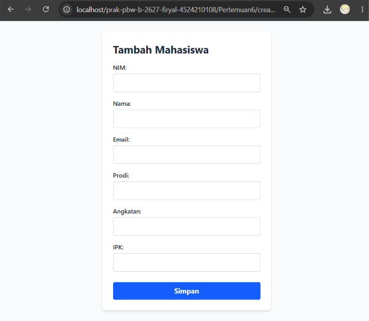

**Hasil Running Setelah Modifikasi**

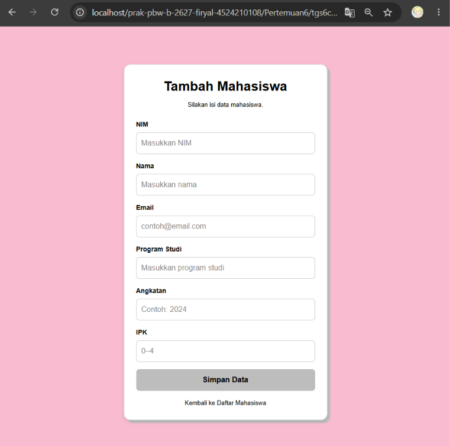

Pada file `tgs6create.php`, modifikasi dilakukan pada tampilan form penambahan data mahasiswa dengan menggunakan warna pink pastel dan cokelat tua. Form juga dilengkapi atribut `required` serta batas nilai angkatan dan IPK agar data yang dimasukkan sesuai dengan ketentuan.

### B. `tgs6edit.php`

**Hasil Running Sebelum Modifikasi**

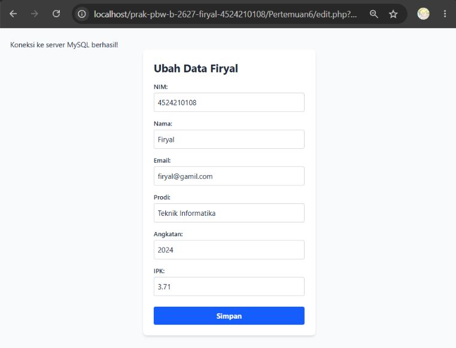

**Hasil Running Setelah Modifikasi**

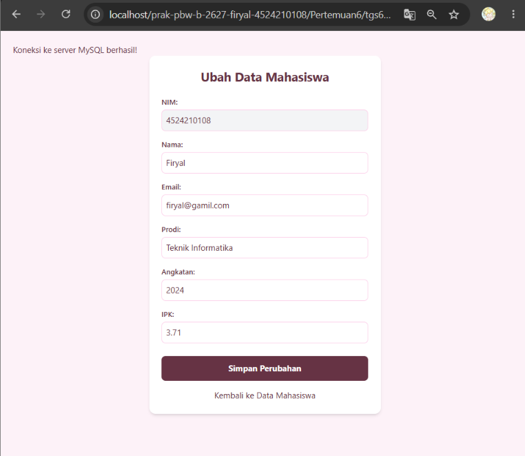

Pada file `tgs6edit.php`, modifikasi dilakukan agar data mahasiswa yang dipilih dapat ditampilkan kembali secara otomatis pada form edit. NIM dibuat tidak dapat diubah, sedangkan data lainnya dapat diperbarui dan dikirim ke file `tgs6update.php`.

### C. `tgs6delete.php`

**Hasil Running Sebelum Modifikasi**

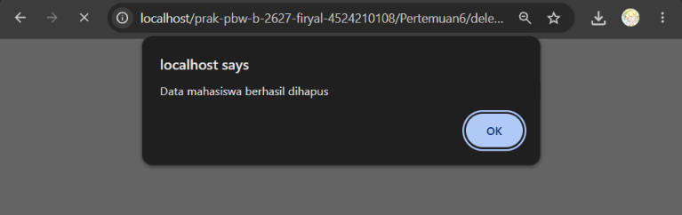

**Hasil Running Setelah Modifikasi**

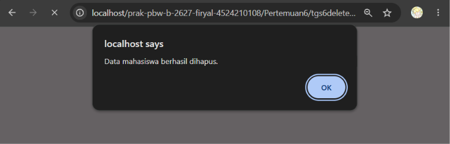

Pada file `tgs6delete.php`, modifikasi dilakukan pada proses penghapusan data mahasiswa berdasarkan NIM. Program menggunakan prepared statement untuk menjalankan query serta menampilkan pesan sesuai hasil penghapusan agar pengguna mengetahui apakah data berhasil dihapus atau tidak ditemukan.

### D. `tgs6update.php`

**Hasil Running Sebelum Modifikasi**

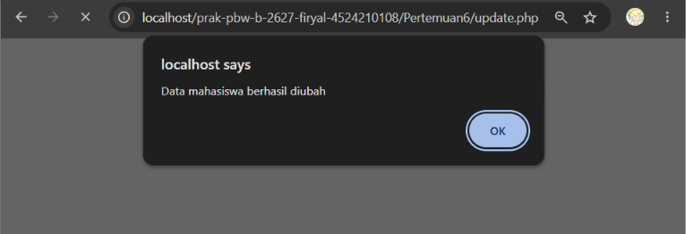

**Hasil Running Setelah Modifikasi**

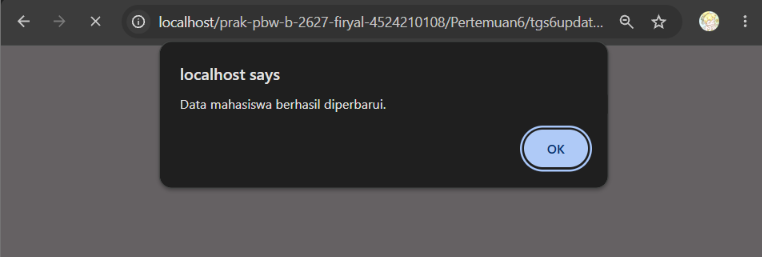

Pada file `tgs6update.php`, modifikasi dilakukan dengan menambahkan pemeriksaan data yang dikirim dan validasi terhadap email, angkatan, serta IPK. Prepared statement digunakan untuk menjalankan perintah `UPDATE`, sehingga perubahan data dilakukan berdasarkan NIM mahasiswa yang sesuai.

### E. `tgs6store.php`

**Hasil Running Sebelum Modifikasi**

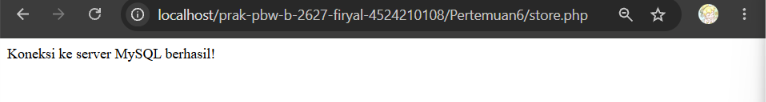

**Hasil Running Setelah Modifikasi**

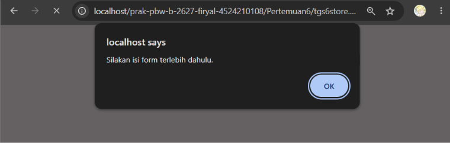

Pada file `tgs6store.php`, modifikasi dilakukan pada proses penyimpanan data mahasiswa. Program memeriksa data yang dikirim melalui metode `POST`, melakukan validasi input, dan menggunakan prepared statement untuk menjalankan perintah `INSERT`. Pesan hasil penyimpanan juga ditambahkan untuk memberi informasi kepada pengguna.

### F. `tgs6index.php`

**Hasil Running Sebelum Modifikasi**

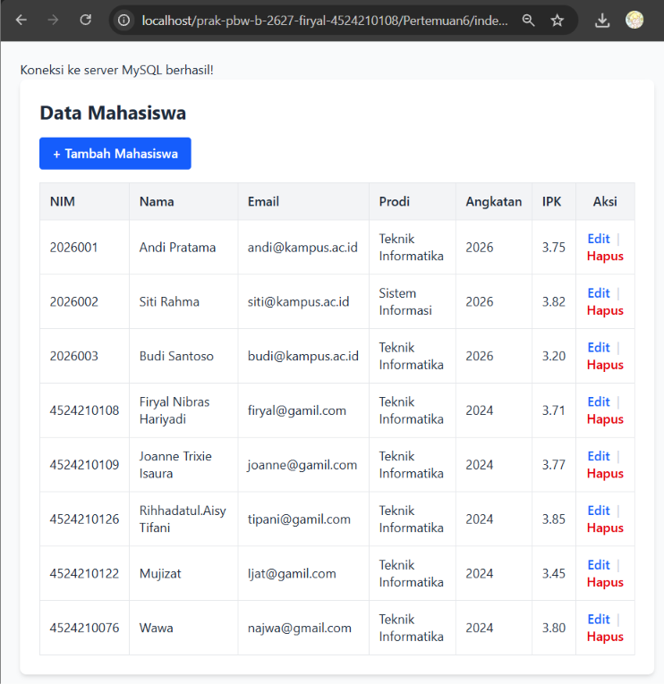

**Hasil Running Setelah Modifikasi**

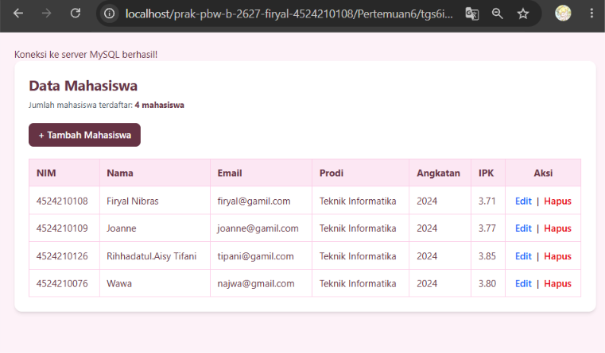

Pada file `tgs6index.php`, modifikasi dilakukan pada tampilan daftar mahasiswa dengan menambahkan jumlah data, tombol Tambah Mahasiswa, serta fitur Edit dan Hapus pada setiap baris. Tampilan tabel juga disesuaikan dengan warna pink pastel dan cokelat tua agar lebih rapi dan konsisten dengan halaman lainnya.

## 2. Lima Bagian Kode Penting

### 1. Menghubungkan Form dengan Proses Penyimpanan

File: `tgs6create.php`

```html
<form action="tgs6store.php" method="POST">
```

Kode ini digunakan untuk mengirimkan data yang dimasukkan melalui form ke file `tgs6store.php` menggunakan metode `POST`. Data tersebut kemudian diproses untuk disimpan ke dalam database.

### 2. Mengambil Data Mahasiswa dari Database

File: `tgs6index.php`

```php
$query = mysqli_query($koneksi, "SELECT * FROM mahasiswa");
```

Kode ini digunakan untuk mengambil seluruh data mahasiswa dari tabel `mahasiswa`. Data yang diperoleh kemudian ditampilkan dalam bentuk tabel pada halaman utama program.

### 3. Menyimpan Data Mahasiswa

File: `tgs6store.php`

```php
$stmt = mysqli_prepare(
    $koneksi,
    "INSERT INTO mahasiswa (nim, nama, email, prodi, angkatan, ipk)
     VALUES (?, ?, ?, ?, ?, ?)"
);
```

Kode ini digunakan untuk menyiapkan perintah `INSERT` guna menyimpan data mahasiswa ke database. Prepared statement membantu memisahkan perintah SQL dari nilai input yang dikirimkan pengguna.

### 4. Memperbarui Data Mahasiswa

File: `tgs6update.php`

```php
$stmt = mysqli_prepare(
    $koneksi,
    "UPDATE mahasiswa
     SET nama = ?, email = ?, prodi = ?, angkatan = ?, ipk = ?
     WHERE nim = ?"
);
```

Kode ini digunakan untuk memperbarui data mahasiswa berdasarkan NIM. Kolom pada bagian `SET` merupakan data yang akan diperbarui, sedangkan kondisi `WHERE nim = ?` menentukan data mahasiswa yang dituju.

### 5. Menghapus Data Mahasiswa

File: `tgs6delete.php`

```php
$stmt = mysqli_prepare(
    $koneksi,
    "DELETE FROM mahasiswa WHERE nim = ?"
);
```

Kode ini digunakan untuk menghapus data mahasiswa berdasarkan NIM. Kondisi `WHERE` memastikan penghapusan ditujukan pada data yang sesuai dengan NIM yang diterima oleh program.
