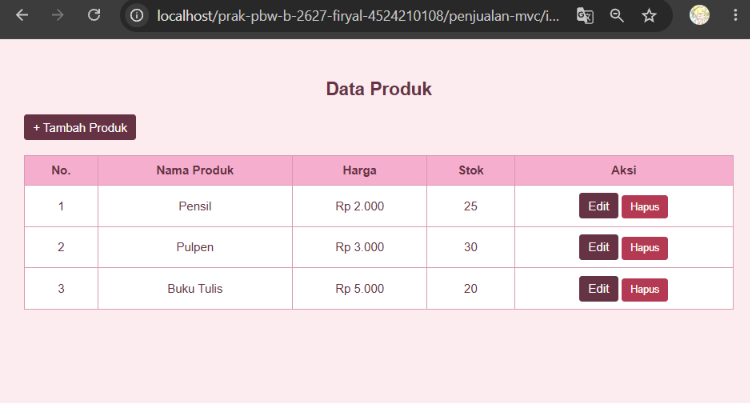
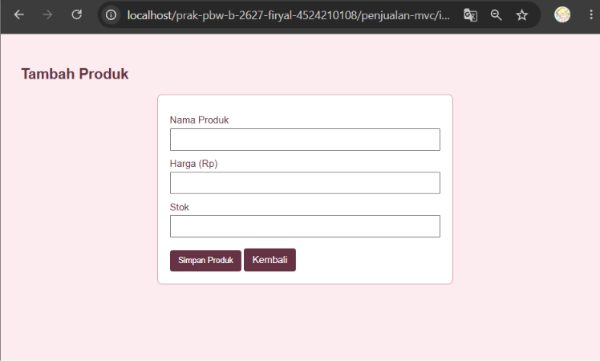
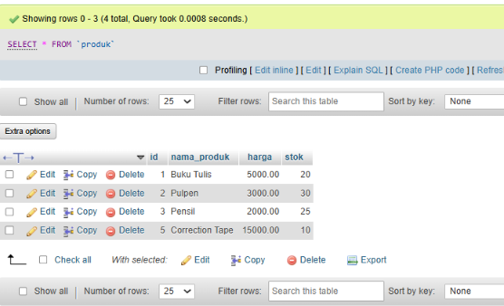

<h1 style="font-size: 18px; margin-bottom: 5px; border: none;">
LAPORAN PRAKTIKUM  
PEMROGRAMAN BERBASIS WEB
</h1>

<i>Laporan ini disusun guna memenuhi penilaian dalam mata kuliah Prak. Pemrograman Berbasis Web</i>

 

  

<b>Disusun Oleh:</b>

<b>Firyal Nibras Hariyadi</b> 
4524210108

 

<b>Dosen:</b>

Ari Wibowo, S.Kom., M.Kom., C. Pro

   

<h3 style="font-size: 16px; margin-bottom: 5px; border: none;">
S1-TEKNIK INFORMATIKA  
FAKULTAS TEKNIK UNIVERSITAS PANCASILA  
<b>2026/2027</b>
</h3>

---

# Tugas Praktikum 7

Pada praktikum 7 ini, saya membuat aplikasi penjualan sederhana menggunakan PHP dan MySQL dengan konsep MVC (Model, View, Controller). Aplikasi ini memiliki fitur untuk menampilkan, menambahkan, mengubah, dan menghapus data produk.

## 1. Hasil Running Program

### A. Daftar Produk

Halaman ini menampilkan daftar produk beserta harga dan stok. Pengguna juga dapat menambahkan, mengedit, atau menghapus produk melalui tombol yang tersedia.

### B. Tambah Produk

Halaman ini digunakan untuk menambahkan produk dengan mengisi nama produk, harga, dan stok. Form dilengkapi validasi untuk memastikan data yang dimasukkan sesuai dengan ketentuan.

### C. Isi Database

Gambar ini menunjukkan data produk yang tersimpan di tabel `produk` pada database `penjualan_mvc`. Setelah produk baru berupa *Correction Tape* ditambahkan melalui aplikasi, data tersebut juga muncul di database.